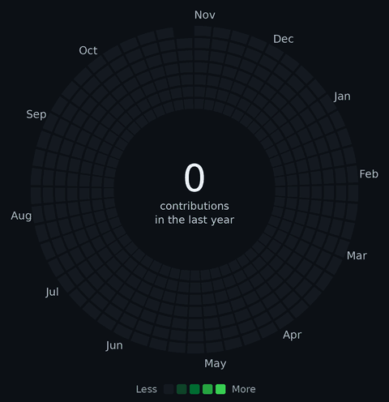
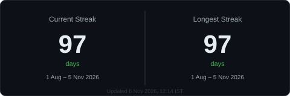

<h1 align="center">
  Eshwar Rao 
  Full-Stack Developer · AI-Powered Applications
</h1>

<table width="100%">
  <tr>
    <td width="56%" valign="top">
      <b>About</b> 
      I enjoy turning ideas into working software&#8212;building across frontend, backend and data layers, and integrating AI where it adds real value. 
      B.Tech &#183; Computer Science &amp; Engineering (IoT) &#183; 2025
        
      <b>Frontend &amp; Mobile</b> 
      React &#183; Next.js &#183; TypeScript &#183; JavaScript 
      Tailwind CSS &#183; React Native &#183; Expo 
      
        
      <b>Backend</b> 
      Node.js &#183; Express.js &#183; NestJS &#183; Python &#183; FastAPI 
      
        
      <b>Databases &amp; ORM</b> 
      PostgreSQL &#183; MongoDB &#183; SQLite &#183; Supabase &#183; Prisma 
      
        
      <b>AI, LLMs &amp; Developer Tools</b> 
      <i>AI &amp; LLM:</i> Gemini API &#183; LangChain &#183; LangGraph &#183; RAG &#183; Ollama &#183; FAISS 
      <i>AI dev environments:</i> Antigravity &#183; VS Code &#183; Claude Code 
      <i>Engineering tools:</i> Git &#183; GitHub &#183; Docker &#183; Postman 
      
    </td>
    <td width="44%" align="center" valign="middle">
       
       
       
      
    </td>
  </tr>
</table>

  <a href="https://www.linkedin.com/in/eshwar-rao-007mj/">LinkedIn</a> &#183;
  <a href="mailto:erao2303@gmail.com">Email</a>

